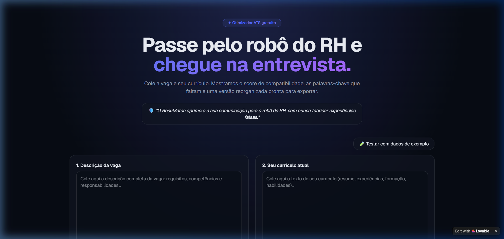
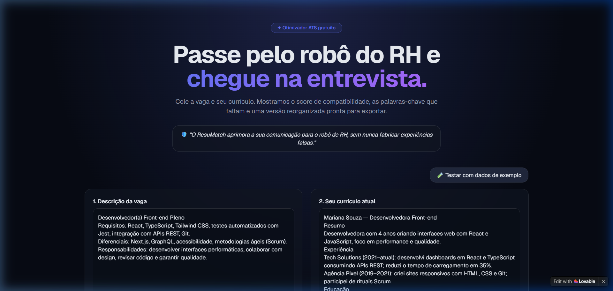
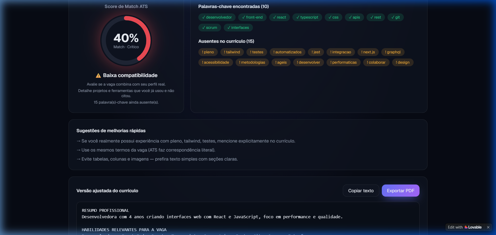
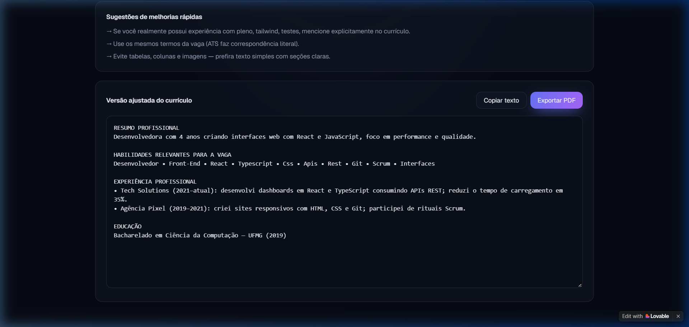

# 🎯 ResuMatch ATS - Otimizador Inteligente de Currículos

> Aplicação web moderna que compara currículos profissionais com descrições de vagas reais e gera uma versão adaptada e amigável para sistemas **ATS (Applicant Tracking Systems)**, com uma regra inegociável: **nunca inventar experiências ou competências que o candidato não possui**.

🔗 **Aplicação em Produção:** [https://resumatch-ats.lovable.app](https://resumatch-ats.lovable.app/)

---

## 📌 1. Qual problema a aplicação resolve?
Muitos profissionais capacitados são eliminados precocemente nos processos seletivos antes mesmo de seus currículos chegarem a um recrutador humano. Isso acontece porque os sistemas **ATS** analisam correspondência textual, termos técnicos e relevância semântica entre o perfil e os requisitos da vaga.

Se o candidato possui a experiência mas utilizou termos diferentes dos solicitados na descrição da vaga (por exemplo, "testes unitários" em vez de "testes automatizados"), o robô de triagem reduz sua nota de compatibilidade.

O **ResuMatch ATS** resolve esse problema identificando as palavras-chave essenciais da vaga, calculando a aderência atual e reorganizando o currículo real do candidato para que a linguagem fique alinhada ao vocabulário da oportunidade, sem fabricar experiências falsas.

---

## 📸 2. Demonstração e Telas da Aplicação

### 🖥️ Tela Inicial & Regra Ética
Interface com tema escuro (Dark Slate), aviso central de integridade ética e campos dedicados para colagem de dados.


---

### 📝 Preenchimento & Dados de Exemplo
Suporte a preenchimento manual ou botão "Testar com dados de exemplo" para demonstração imediata.


---

### 📊 Score de Compatibilidade & Diagnóstico de Palavras-Chave
Cálculo percentual do Match ATS, separação visual de termos encontrados (verdes) e ausentes (âmbar), além de sugestões práticas de aprimoramento.


---

### 📄 Currículo Otimizado & Exportação
Visualizador com o currículo reestruturado em seções profissionais (*Resumo, Habilidades Relevantes para a Vaga, Experiência Profissional e Educação*), pronto para copiar ou exportar em PDF.


---

## ⚙️ 3. Como a Análise Funciona (Fluxo de Dados)

```
[ Descrição da Vaga ] ──┐
                         ├─► [ Tokenização & Extração de Palavras-chave ]
[ Currículo Atual   ] ──┘                 │
                                          ▼
                               [ Cálculo do Match ATS ]
                             (Frequência e Coincidência)
                                          │
                   ┌──────────────────────┴──────────────────────┐
                   ▼                                             ▼
       [ Diagnóstico Visual ]                        [ Reestruturação Semântica ]
• Score % (Excelente/Médio/Crítico)            • Mantém apenas fatos reais
• Termos Encontrados vs Ausentes               • Destaque nas habilidades da vaga
• Recomendações acionáveis                     • Exportação em PDF / Copiar Texto
```

1. **Entrada:** O usuário cola a descrição da vaga e o texto do seu currículo (ou clica em "Testar com dados de exemplo").
2. **Processamento:** O algoritmo faz a extração de termos-chave de ambas as fontes, limpando stopwords e normalizando os dados.
3. **Cálculo de Match:** Mede a porcentagem de cobertura dos requisitos da vaga que estão explícitos no currículo.
4. **Geração da Versão Otimizada:** Reorganiza a estrutura textual do currículo, priorizando as habilidades e realizações mais relevantes para aquela oportunidade específica.

---

## 💬 4. O Mega Prompt Utilizado

Para a geração da aplicação completa no **Lovable.dev**, foi utilizado o seguinte prompt estruturado em Markdown:

```markdown
# Projeto: ResuMatch ATS - Otimizador de Currículo para Vagas

Crie uma aplicação web moderna, responsiva e elegante voltada para ajudar candidatos a adaptarem seus currículos para passarem em filtros de ATS (Applicant Tracking Systems).

## ⚠️ Regra Fundamental Inegociável
A aplicação otimiza a apresentação, destaca competências reais e alinha a semântica do currículo com a vaga, mas NUNCA deve inventar experiências, formações ou habilidades que não constem no currículo original. Mostre este aviso de forma visível e elegante na interface: "O ResuMatch aprimora a sua comunicação para o robô de RH, sem nunca fabricar experiências falsas."

## 🎨 Design System e Identidade Visual
- Framework de estilo: Tailwind CSS + shadcn/ui.
- Cores: Dark mode / Slate elegante (fundo escuro neutro #090d16 ou cinza ardósia clean, destaques em Índigo/Violeta e indicadores de match em Verde Esmeralda e Âmbar).
- Tipografia moderna (Inter ou Geist), layout limpo com cantos arredondados (rounded-xl), efeitos de glassmorphism sutis e microinterações suaves nos cards e botões.

## 📱 Estrutura de Telas e Fluxo do Usuário

### 1. Cabeçalho / Hero Section
- Título impactante: "Passe pelo robô do RH e chegue na entrevista."
- Subtítulo explicativo com badge de destaque.

### 2. Seção de Entrada (Dois painéis lado a lado no Desktop, empilhados no Mobile):
- Painel 1 (Vaga): Área de texto para descrição completa da vaga.
- Painel 2 (Currículo Atual): Área de texto para o texto do currículo do candidato.
- Botão Principal: "Analisar Compatibilidade & Otimizar".

### 3. Painel de Resultados (Exibido após o clique):
- Score de Match ATS: Gráfico circular ou barra de progresso animada com porcentagem e classificação.
- Diagnóstico de Palavras-chave:
  - Badges verdes: Palavras-chave e competências encontradas.
  - Badges vermelhas/âmbar: Palavras-chave essenciais ausentes.
- Sugestões de Melhorias Rápidas: Lista de recomendações práticas.

### 4. Versão Ajustada do Currículo (Pronta para Exportar):
- Um editor/visualizador com o currículo reformulado em seções profissionais (Resumo, Habilidades Relevantes, Experiência Profissional, Educação).
- Opção de copiar o texto com 1 clique.
- Botão para exportar/imprimir em PDF.

## ⚙️ Lógica e Mock da Aplicação
- Algoritmo de análise para extração de termos comuns, cálculo de sobreposição e reescrita semântica.
- Botão "Testar com dados de exemplo" para preenchimento imediato.
```

---

## 🔄 5. Ajustes e Refinamentos Realizados

Após a primeira geração no Lovable, os seguintes refinamentos foram solicitados:
1. **Botão de Exemplo ("Testar com dados de exemplo"):** Incluído para que qualquer visitante ou recrutador consiga testar o fluxo completo em 1 clique sem precisar colar textos longos.
2. **Exportação Direta em PDF:** Implementação do botão "Exportar PDF" formatando o currículo diretamente para impressão limpa (sem elementos residuais da interface).
3. **Reforço Ético em Destaque:** Ajuste no componente de alerta visual para que a regra de nunca criar informações falsas ficasse em evidência no topo da página.

---

## 🛠️ 6. Tecnologias Utilizadas
* [Lovable.dev](https://lovable.dev/) - Plataforma de desenvolvimento assistido por IA
* [React](https://react.dev/) + [Vite](https://vitejs.dev/)
* [Tailwind CSS](https://tailwindcss.com/)
* [shadcn/ui](https://ui.shadcn.com/)
* [Lucide Icons](https://lucide.dev/)

---

Desenvolvido como projeto prático no Desafio DIO & Lovable.
